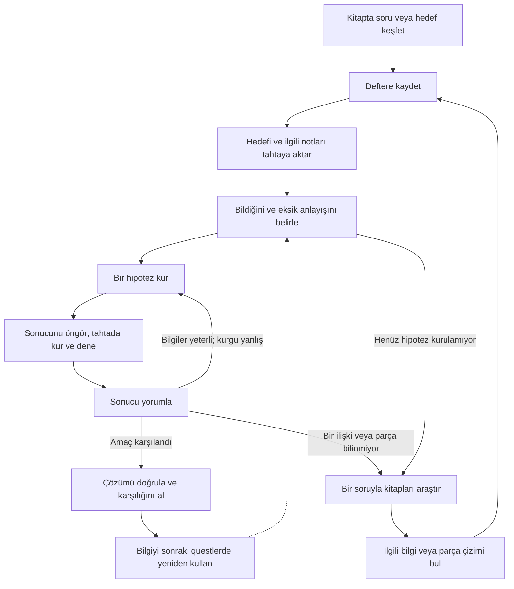
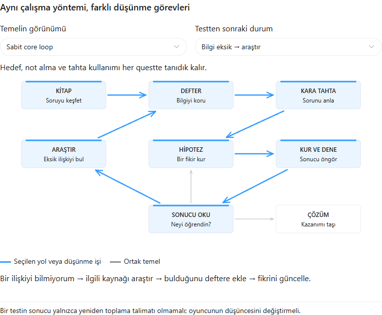

# Kitap–Defter–Kara Tahta: Puzzle Tasarım Temeli

**Sürüm:** 0.1 · **Tarih:** 25 Ekim 2026 · **Durum:** Birlikte değerlendirilecek tasarım taslağı.

Bu belge yeni bir quest değildir. Gelecekte eklenecek questlerin aynı anlaşılır oynanışa dayanırken farklı düşünme deneyimleri sunması için ortak referanstır. Oyuna uygulanmış özelliklerle öneriler Bölüm 12'de ayrılır. Bu çalışma oyun kodunu değiştirmez.

**Tasarım cümlesi:** Oyuncu kitaplarda bir sorun keşfeder, defterinde bilgiyi biriktirir, tahtada bir fikir kurar; neyi bilmediğini anlayarak araştırır, bulduklarını yorumlar ve çözümünü kanıtlar.

**Değişmeyen şey oyuncunun çalışma yöntemi; değişen şey çözmek için kurduğu düşüncedir.** Yüz farklı questin ilgi çekici olacağı bu belgeyle garanti edilemez. Ama tekrarın nereden geldiğini ölçmek ve yeni içerikleri elemek için somut bir temel kurulabilir.

## 1. Oyuncuyla yaptığımız anlaşma

Her questte oyuncu şu üç soruyu cevaplayabilmelidir:

1. **Ne çözmeye çalışıyorum?** Sonuç veya sorun anlaşılırdır; çözümün kendisi verilmez.
2. **Şimdi ne yapabilirim?** Eldeki bilgiyi yorumlamak, tahtada denemek veya belli bir soruyla araştırmak mümkündür.
3. **Neden ilerledim veya ilerleyemedim?** Bir not, bir çıkarım veya test sonucu anlamlı bir değişiklik yaratır.

Oyuncu hedefin, defterin ve tahtanın kullanımını tekrar öğrenmez. Her quest ona yeni bir düşünce ilişkisi sunar. Karmaşık arayüz, uzun yürüyüş, küçük yazı veya saklı bir tıklama noktası zihinsel zorluk yerine geçmez.

Laboratuvar atmosferinde kitapların dili katalog, araştırma notu, deney karşılaştırması ve gözlem olabilir. Atmosfer bilgiyi taşır; anlaşılması gereken kuralı belirsizleştirmez. Dünya hakkındaki kesin olmayan hikâye ayrıntıları bu temel tarafından karara bağlanmaz.

## 2. Sabit core loop

Bu bir zorunlu tören değildir. Oyuncu yeterli bilgiye sahipse kitaplara geri gönderilmez. Denemeden önce araştırabilir; birden fazla hipotezi karşılaştırabilir; yeni bulduğu bilgiyle tahtaya dönmeden defterde de çıkarım yapabilir. Hipotezin beklenen bir sonucu vardır: oyuncu neyi denediğini ve sonucun hangi fikri destekleyeceğini anlayabilmelidir. Bunu zorunlu bir tahmin yazma ekranına dönüştürmek gerekmez.

| Alan | Temel işi | Oyuncunun sahip olduğu karar |
|---|---|---|
| Kitap | Hedef, parça çizimi, genel bilgi ve gözlem sunmak | Hangi sorunun peşine düşeceğim, neyi kaydedeceğim? |
| Defter | Keşfi korumak, kaynakları hatırlatmak ve eski bilgiyi erişilebilir tutmak | Hangi eski bilgi bu soruna yarıyor? |
| Kara tahta | Düşünceyi somut bir çözüm denemesine dönüştürmek | Neyi kullanacağım, nasıl ilişkilendireceğim, neyi değiştireceğim? |
| Test sonucu | Denemeye anlaşılır bir karşılık vermek | Hangi varsayımımı koruyacağım veya değiştireceğim? |

Görselde araştırmaya dönülen yol seçilidir. [Etkileşimli rehber](PuzzleFoundationVisual.html), yalnız düzeni değiştirerek devam etme ve doğrudan çözüm yollarını da gösterir.

Defter oyuncunun hafızasına yardım eder; gerekli çıkarımı onun yerine yapmaz. Tahta yalnız teslim noktası değil, çalışma alanıdır. Bunlar her questte aynı rolleri korur.

## 3. Quest ile bilgi aynı paket değildir

İçerik tasarımında beş şey birbirinden ayrılır. Bunlar zorunlu beş arayüz sekmesi değildir.

| İçerik | Neyi sağlar? | Tekrar kullanımı |
|---|---|---|
| Hedef | Çözülecek sorunu ve başarı koşulunu tanımlar | Aynı bilgi farklı hedeflere hizmet edebilir |
| Parça çizimi | Oyuncunun tahtada kullanabileceği bileşeni tanıtır | Yalnız bir questin tüketilecek kartı değildir |
| Genel bilgi | Bir özelliği, kısıtı veya ilişkiyi öğretir | Birden çok questte anlam kazanabilir |
| Gözlem | Belirli koşul altında ne olduğunu gösterir | Başka bir kaydı yorumlatabilir |
| Hipotez | Oyuncunun bilgilerden çıkardığı açıklamadır | Oyuncuya aittir; hazır çözüm kartı değildir |

**Bilgiyi bulmak ile onu kullanmayı anlamak ayrı ilerlemelerdir.** Bir parçayı elde etmek, doğru yerini otomatik göstermemelidir. Genel bir bilgi de bulununca otomatik olarak tek bir questin cevabına çevrilmemelidir.

Bu sistemde toplanan parça, mevcut döngüdeki gibi bir çizim/bilgi olabilir. Fiziksel malzeme toplama, üretim ekonomisi veya tüketim sistemi burada varsayılmaz.

Üç keşif sırası geçerlidir:

- **Hedef önce:** Sorunu görürüm; ihtiyaç duyduğum özelliği veya ilişkiyi araştırırım.
- **Bilgi önce:** Anlamını hemen bilmediğim bir kaydı saklarım; ileride bir hedef onu anlamlandırır.
- **Karışık:** Bazı şeyler elimdedir; yeni hedef eski notlarımı yeniden düşündürür, yalnız kalan eksikliği araştırırım.

Hedefi bulmadan önce alınmış doğru bilgi, hedef keşfedilince yeniden toplanmak zorunda kalmaz. Hedefi tahtaya sabitlemek dışında, doğru çözümü sırf gizli bir "bütün ipuçlarını topladı" bayrağı eksik diye reddetmeyiz. Gereken bilginin tamamı bir kitapta bulunabilir; fakat bütün questleri hedef+adaylar+kurallar paketi olarak aynı kitapta sunmak temel kuralımız değildir.

## 4. Kitap araştırmasının nedeni: tarif edilmiş bir bilinmez

Araştırmaya dönen oyuncunun aklında bir soru olmalıdır. "İki kartım eksik" yerine "Bu iki parçanın doğrudan temas edip edemeyeceğini bilmiyorum" diyebilmelidir.

| Eksikliğin türü | Oyuncunun sorusu | Sonraki anlamlı hareket |
|---|---|---|
| Kullanılabilir parça eksik | Bu işi yapabilecek hangi bileşen var? | Parça çizimleri ve özelliklerini araştır |
| Bilgi eksik | Bu parçalar hangi koşulda uyumlu? | Deney kaydı veya genel kural ara |
| Çıkarım eksik | Bilgiler elimde ama birbiriyle nasıl ilişkili? | Defterde karşılaştır, tahtada alternatif kur |
| Kurulum hatalı | Fikrim doğru olabilir; hangi bağ bunu bozuyor? | Gözlemi kullanıp tahtayı düzelt |

Araştırılacak yönü kitap başlığı, bölüm adı, ortak deney numarası, tekrar eden parça çizimi veya kaynak göndermesiyle anlaşılır kılarız. Doğru sayfanın rastgele bütün kitapları tarayarak bulunması tek yol olmamalıdır. Aynı temel bilgiye farklı kaynaklardan ulaşılabilmesi düşünülür; bunun için her notun kopyasını zorunlu kılmayız.

Bir notun değeri bulunduktan sonra bir kararı değiştirmesidir: adayı elemek, yeni ihtimali açmak, eski yorumu düzeltmek veya bir hipotezi desteklemek. Bunu yapmayan not zorunlu ilerleme malzemesi sayılmaz.

## 5. Tekrarı önleyen asıl değişken: düşünme görevi

Sabit araçlarla farklı zihinsel işler yaptırabiliriz. Aşağıdakiler quest aileleridir; her biri için yeni bir kontrol sistemi gerekmez.

| Aile | Oyuncunun baskın sorusu | Tahtadaki karşılığı | Araştırmanın amacı |
|---|---|---|---|
| **Seç ve ele** | Hangi aday bütün koşulları birlikte karşılıyor? | Parça seç, bağla | Benzer adayların kritik farkını öğren |
| **Düzeni çıkar** | Parçalar belli; komşulukları nasıl olmalı? | Bağları kur ve düzelt | İlişkileri birleştir |
| **Hatayı teşhis et** | Çalışmayan öneride yanlış olan varsayım ne? | Deneme olarak verilen düzeni kur, hatalı bağı sil/değiştir | Başarılı ve başarısız gözlemleri karşılaştır |
| **Bilgiyi aktar** | Eski çözümün hangi ilkesi burada da geçerli? | Tanıdık bir alt yapıyı yeni düzende kullan | Eski notun yeni bağlamını fark et |
| **Koşulları uzlaştır** | Tek tek uygun görünen kararlar neden birlikte çalışmıyor? | Birbirini etkileyen seçimleri yeniden düzenle | Bir notu başka bir notla birlikte yorumla |
| **Hipotez ayır** | İki açıklamadan hangisi doğru? | Anlamlı fark taşıyan alternatifleri kurup test et | Eksik ayırt edici bilgiyi veya gözlemi bul |

Bir questte bir baskın aile seçilir; gerekiyorsa bir destek aile eklenir. Hepsini aynı anda kullanmak hedef değildir. "Şu başlık altındaki bütün kartları tak" veya "şu özelliğe uyan kartı koy" sürekli tek zihinsel görev hâline gelmemelidir. Bu aileler içerik tasarımı dilidir; hepsinin bugünkü quest veri biçimi ve geri bildirimleriyle doğrudan desteklendiği iddia edilmez. Eksik şema görünümü veya ayırt edici test bilgisi gerekiyorsa bu destek ayrıca tanımlanır; olmayan bir fizik simülasyonu varsayılmaz.

**Tekrar testi:** Son questin isimlerini, renklerini ve hikâye metnini çıkar. Oyuncunun gerekçeli karar sırası yeni questte de aynı kalıyorsa bu yeni bir düşünme deneyimi değil, aynı alıştırmanın varyantıdır. Varyantlar öğretimde ve kısa pekiştirmede kullanılabilir; ilerlemenin tamamını oluşturmaz.

## 6. Her questin değişebileceği yüzeyler

| Değişken | Olası farklılıklar | Sadece bunu değiştirmek neden yetmez? |
|---|---|---|
| Başlangıçta bilinen | Parçalar belli / düzen belli / başarısız bir öneri belli | Bilinmeyen sayısını artırmak aynı işlemi uzatabilir |
| Bilgilerin ilişkisi | Birbirini tamamlar / bir koşula bağlıdır / iki hipotezi ayırır | Daha çok metin her zaman daha çok düşünce değildir |
| Çözümün yapısı | Seçim / komşuluk / hata düzeltme / bilinen yapıyı yeniden kullanma | Farklı şekiller aynı karar dizisini saklayabilir |
| Araştırma yönü | Yeni bir özellik / eski not / deney karşılaştırması | Uzak kaynak tek başına zorluk değildir |
| Öğrenilen şey | Yeni ilke / eski ilkenin sınırı / iki ilkenin ilişkisi | Aynı kuralı sürekli yeniden öğretmek ilerleme hissini keser |
| Karşılık | Kullanılabilir bilgi veya bileşen / anlamlı ilerleme / deneyin anlaşılması | Sadece başarı bildirimi uzun vadede yetersiz kalabilir |

Pratik tasarım önerisi: Arka arkaya ana questlerde baskın düşünme işini ve en az bir başka yüzeyi değiştirmeyi dene. Bu bir otomatik çeşitlilik garantisi veya katı kota değildir. Eğlence, oynanış testiyle değerlendirilir.

## 7. Zorluk ve öğrenme

Zorluğu önce çıkarım derinliğiyle kurarız: Bir sonuç başka bir kararın dayanağı olur. Sonra adayların benzerliğini ve aynı anda tutulacak ilişkileri ayarlarız. Parça sayısı ve kaynak uzaklığı tek başına seviye ölçüsü değildir.

Önerilen öğrenme düzeni:

1. **Yöntemi öğren:** Hedefi al, notu koru, tahtada basit ilişkiyi kur, sonucu oku.
2. **Kendi sorunu üret:** Hangi özelliği bilmediğini hedef üzerinden anla; onu araştır.
3. **Bilgileri birlikte kullan:** İki notun kesişimi, tek başına hiçbirinin vermediği sonucu versin.
4. **Eski bilgiyi yeni bağlama taşı:** Bir önceki çözümü kopyalamak yerine ilkesini kullan.
5. **Ustalık:** Tanıdık kurallardan daha derin sonuçlar çıkar; farklı quest aileleri arasında geçiş yap.

Bunlar quest numarası aralıkları değildir. İlerideki questin mutlaka daha büyük veya daha uzun olması gerekmez. Derin bir questten sonra kısa bir uygulama ritmi rahatlatabilir.

Yeni bir tahta işlemi gerekirse — örneğin aynalı kopyalama veya tanınan bir form değişimi — önce açık, kısa bir örnekle öğretilir; daha sonra başka bağlamlarda yeniden kullanılır. Her quest için tek kullanımlık özel kontrol eklemeyiz. Mevcut araçlarla iyi quest üretilebilmesi bu temelin ilk sınamasıdır.

## 8. Adil bilgi ve anlaşılır geri bildirim

- Çözümde gerekli her kural ulaşılabilir bir kaynakta veya daha önce öğretilmiş bir bilgide bulunur. Tasarımcının kafasındaki fizik/kimya bilgisini oyuncudan varsaymayız.
- Gözlem bir koşula bağlıysa koşul görünürdür. Yanlış araştırma kaydı kullanılacaksa güvenilmezliği değerlendirmenin kanıtı da vardır; keyfî yalan zorluk sayılmaz.
- Deneme geri alınabilir olur. Mevcut başarısız denemede parçaları koruma davranışı araştırmayı destekler.
- Test, tasarımın gerçekten doğrulayabildiği şeyi bildirir. "Şu koşul karşılanmadı" türü geri bildirim uygundur; tanımlanmamış fizik simülasyonuna ait sonuçlar uydurulmaz.
- Test mesajı gizli parça kimliğini veya hazır çözümü açıklamaz. Oyuncunun bir sonraki düşüncesine yetecek gözlemi verir.
- Kademeli yardım önce hedefi netleştirir, sonra ilgili kaynak türünü, sonra ilişkiyi işaret eder. Tam çözüm ayrı ve isteğe bağlı tutulur.
- Arayüz başarı koşulunu açık tutar. Gerekçesiz şekilde "bilgi mi eksik, giriş mi algılanmadı, kurgu mu yanlış" belirsizliği yaratmaz.
- Araştırma sırasında kitabı kapatmak veya tahtadan ayrılmak notları ve çalışma durumunu yok etmez. Sıfırlama düşünmeyi tekrar etmeye zorlamaz.

## 9. Yüzüncü quest için üretim disiplini

Amaç yüz ayrı araç değil, bilinen araçlarla farklı düşünme hikâyeleridir. Üretim çizelgesinde her quest için baskın aile, kilit çıkarım, yeniden kullanılan bilgi, yeni öğrenme ve araştırma sorusu kaydedilir. Sayılar yerine yan yana duran düşünce izleri karşılaştırılır.

Geniş içerik üretiminden önce küçük bir temsil grubu hazırlanır: farklı ailelerden questler aynı araçlarla denenir. Oyuncuya çözüm öğretmeden şu durumlar gözlenir:

- Hedefi kendi cümlesiyle anlatabiliyor mu?
- Araştırmaya döndüğünde ne aradığını söyleyebiliyor mu?
- Yeni nottan sonra farklı bir karar veriyor mu?
- Başarısız denemeyi açıklayıp anlamlı bir düzeltme yapabiliyor mu?
- Daha önce öğrendiği bilgiyi hatırlayıp kullanıyor mu?
- Çözümü neden doğru bulduğunu açıklayabiliyor mu?

Süre tek başına değerlendirme değildir. Uzun süren anlamlı düşünme ile kör arama ayrılır. Bu gözlemler alınmadan "100 quest boyunca tekrar hissettirmez" iddiasında bulunulmaz.

## 10. Yeni quest ekleme akışı

1. [Quest tasarım şablonunu](PuzzleQuestTemplate.md) kopyala.
2. Önce hedefi ve kilit çıkarımı yaz; sonra parça ve notlarını seç.
3. Tam çözümün hangi bilgi zincirinden çıkarıldığını yaz. Her kararı bir kanıta bağla.
4. Bilgiyi kaynaklara dağıt; hedef-önce, bilgi-önce ve karışık keşfi kontrol et.
5. Araştırma motivasyonunu yaz: Oyuncu hangi soruyla hangi kaynak türüne dönecek?
6. Son questlerle düşünce sırasını karşılaştır. Gerekçeli bir fark yoksa yeniden tasarla veya pekiştirme olarak etiketle.
7. Kağıt üzerinde oynat; sonra gereken mevcut araçlarla küçük bir oyun denemesi yap.
8. Yeni işlem gereksinimini ayrı karar olarak değerlendir. İçeriği kurtarmak için otomatik yeni mekanik ekleme.

## 11. Yayına aday bir questin geçmesi gereken kontroller

- [ ] Hedefin anlaşılır bir başarı koşulu var.
- [ ] İlk anlamlı hareket oyuncuya açık.
- [ ] Eldeki bilgiyle kurulabilecek en az bir gerekçeli hipotez veya araştırma sorusu var.
- [ ] Kilit çıkarım, bulunan bilgiden türetilebiliyor.
- [ ] Oyuncunun her zorunlu notu neden isteyeceği açıklanabiliyor.
- [ ] Gerekli kaynaklara erişim çözümün kendisinin arkasında kilitli değil.
- [ ] Bilgi, parça ve hedefin farklı keşif sıraları çalışıyor.
- [ ] Zorunlu toplama bayrağı doğru çözümü gereksiz yere engellemiyor.
- [ ] Başarısızlık geri alınabilir ve işe yarayan bilgi sağlıyor.
- [ ] Birden çok mantıksal çözüm varsa ya hepsi kabul ediliyor ya farkı açıklayan görünür bir koşul var.
- [ ] Yenilik yalnız isim, görünüm, sayı veya kaynak uzaklığından gelmiyor.
- [ ] Kullanılan yeni kural/işlem önceden öğretilmiş veya burada adil biçimde tanıtılmış.
- [ ] Sonucun oyuncu için anlaşılır bir karşılığı var.
- [ ] Oyuncu testi ile çözümün adilliği ve tekrar hissi değerlendirildi.

## 12. Mevcut oyun ile bu taslağın arasındaki fark

Bu bölüm uygulama listesi değildir; önerileri mevcut özelliklerle karıştırmamak içindir.

| Konu | Mevcut dayanak | Bu temelin önerisi |
|---|---|---|
| Kitap–defter–tahta | Hedef/parça/bilgi kopyalama, hedef sabitleme, tek/çift bağ ve silme mevcut | Aynı çalışma düzenini koru |
| İlk iki alıştırma | İki bilinmeyenli benzer şema ve doğrudan aday eleme | Öğretici örnek olarak kullan; bütün içeriği aynı aileye bağlama |
| Bilgi sunumu | Bilgiler quest başlığında gruplanıyor, eksik ipucu yuvaları gösteriliyor | Genel bilgiyi arşivleyebil; otomatik eşleştirmenin oyuncunun çıkarımını elinden almamasını değerlendir |
| Erken bilgi keşfi | Çözümlenen bir ipucu, hedef henüz alınmasa da ilişkili quest grubunu açığa çıkarabiliyor | Hedefi bulmadan bilginin hangi soruya ait olduğunun otomatik açıklanıp açıklanmayacağını ayrıca kararlaştır |
| Bilgi panosu | Başka questle ilişkilendirilen kart aktif hedefe kabul edilmeyebiliyor | Yeniden kullanılabilir bilgiye ve oyuncunun kendi ilişkilendirmesine uygun sunumu ayrıca tasarla |
| Toplama kapıları | Tahta doğrulaması tüm ipucu kartlarının toplanmasını/panoya takılmasını şart koşmuyor | Bu esnekliği koru; keşfedilen, seçilen ve tamamlanan hedefleri içerik akışında açıkça ayır |
| Şema görünümü | Hedef düğümleri ve bağları gösterilebiliyor | Hangi kısımların bilineceğini quest ailesine göre seçmek ek görünüm desteği gerektirebilir |
| Doğrulama | Kimlik, adet, komşuluk, bağ türü ve tanımlı kurallar denetleniyor; bilinmeyen düğümün kayıtlı gizli kimliği tek başına zorunlu tutulmuyor | Kesin cevap ancak erişilebilir kanıtlar onu tekilleştiriyorsa istenir; aksi hâlde koşullara uyan alternatifler kabul edilir. Kabul edilen çözümleri ayrıca kontrol et |
| Yeni tahta davranışları | Ayna, üst üste çizim veya serbest şeklin anlamsal okunması mevcut doğrulama değildir | Temelin şartı yapma; gerekçesi ve öğretimiyle ayrı genişleme olarak tasarla |
| Çıktı ve ödül | İki alıştırma ürün vermiyor; sentez akışında ürün alanları var | Her quest için uygun karşılığı tasarla; otomatik mevcut sayma |

Kaynaklar: [Tahta belgeleri](BoardDocuments.md), [İkinci alıştırma](SecondPractice.md), [QuestBlueprintSO](../Assets/Scripts/PuzzleSystems/Chalkboard/QuestBlueprintSO.cs), [SynthesisGraphValidator](../Assets/Scripts/PuzzleSystems/Chalkboard/SynthesisGraphValidator.cs), [Bilgi arşivi](../Assets/Scripts/UI/NotebookWorkspaceController.Information.cs), [ChalkboardManager](../Assets/Scripts/Managers/ChalkboardManager.cs).

## 13. Bu belgeyi genişletme kuralı

Onaylanmış temel ilkeler, yeni quest örneklerinden ayrı tutulur. Yeni bir quest için yöntemi baştan yazmak yerine [şablon](PuzzleQuestTemplate.md) doldurulur. Yeni ortak bir kural gerektiğinde bu belgeye neden, öğretim biçimi ve eski questlerle uyumu eklenir; değişiklik tarihi kaydedilir.

Bu sürümde özellikle **oyuncunun açık hedefi, serbest keşif sırası ve değişen düşünme görevi** merkezdedir. Quest sayısı, kesin zorluk eğrisi, yeni tahta araçları ve ödül ekonomisi henüz kararlaştırılmamıştır.

Görsel eşlikçi: [Etkileşimli tasarım rehberi](PuzzleFoundationVisual.html). Düzenlenebilir görsel kaynak: [HTML parçası](PuzzleFoundationVisual.fragment.html). Yeni quest üretimi: [Doldurulabilir şablon](PuzzleQuestTemplate.md).
