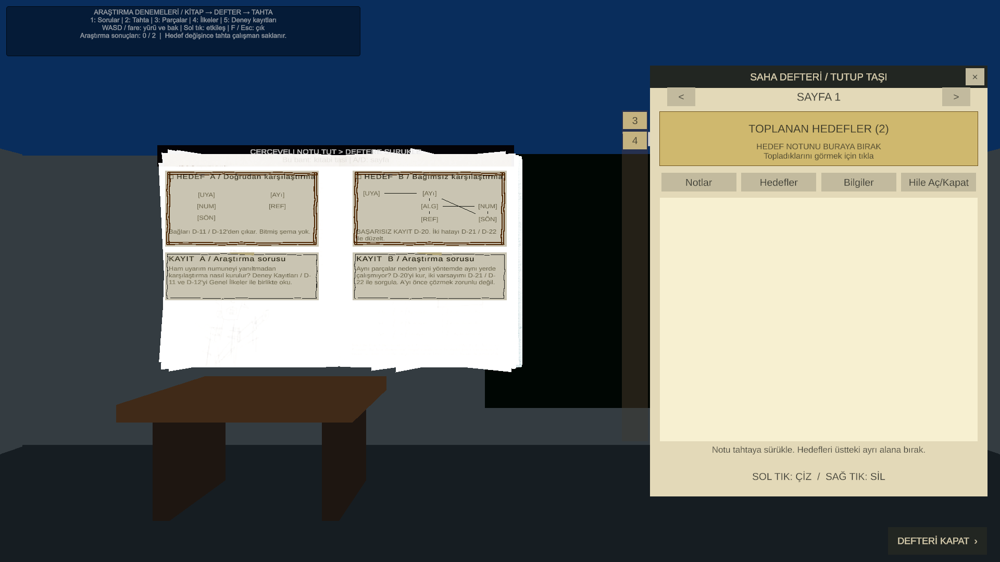
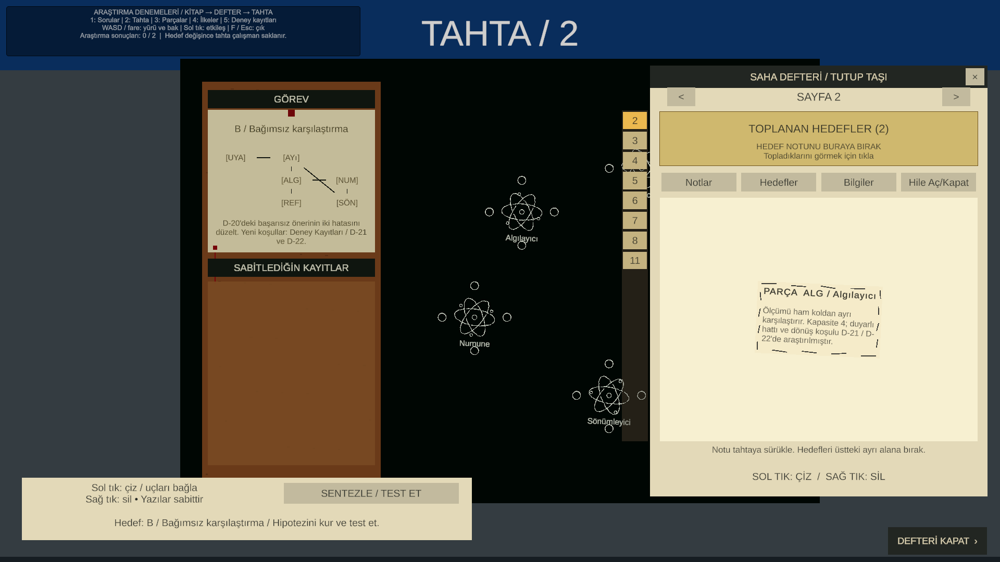

# Test sahnesi: iki araştırma örneği

**Şu anda test sahnesinde [Çift Kayıt testi](SignalTrialPlaytest.md) etkindir.** [İkinci İz](SecondTraceTrial.md) ve aşağıdaki A/B içerikleri korunur; kendi kurulum menülerinden yeniden açılır.

Sahne: `Assets/Scenes/scn_SynthesisBlockout.unity`. Yalnız bu sahneyi açıp Play'e bas.

Bu iki örnek [tasarım temelinin](PuzzleDesignFoundation.md) oynanabilir denemeleridir. İlkinde bilinen parçaların ilişkilerini çıkarırsın; ikincisinde başarısız bir öneriyi teşhis edersin. Aynalama, gizli şekil tanıma veya yeni bir fizik simülasyonu yoktur: mevcut kitap, defter, tebeşir ve bağ işlemleri kullanılır.

## Kitaplar ve kontroller

| Tuş | Kaynak | İçerik |
|---|---|---|
| **1** | Araştırma Soruları | A ve B hedefleri; B'deki şema açıkça başarısız bir kayıttır |
| **2** | Kara tahta | Hedefi sabitle, parçaları yaz, kayıtları karşılaştır ve test et |
| **3** | Parça Atlası | Altı ortak bileşen; çizimler questler arasında yeniden kullanılır |
| **4** | Genel İlkeler | Yalıtım, duyarlı hat ve deney sınırları |
| **5** | Deney Kayıtları | D-11/D-12 doğrudan yöntem, D-20 başarısız öneri, D-21/D-22 yeni yöntem |

Kitaplar odada ayrı masalarda da bulunur. WASD/fareyle gezip sol tıkla açabilirsin; sayı tuşları test için hızlı erişimdir. Kitapta A/D sayfa çevirir. F veya Esc etkileşimden çıkar.

Dört kitabın dış kapağında ve rafta görünen sırtında kendi adı vardır: **Araştırma Soruları**, **Parça Atlası**, **Bağ İlkeleri**, **Deney Kayıtları**. Başlıklar yalnız test sahnesindeki örneklere eklenir ve mevcut kapak/sırt kemiklerini izler. Yeniden uygulamak için **Senzora > Araştırma Denemeleri > Kitap Kapaklarını Adlandır** menüsünü kullan. Bu adlar otomatik bir okundu/okunmadı takibi yapmaz.

25 Ekim 2026: Unity derlemesi hatasız tamamlandı; kapak ve sırt yakın görüntüleri ile Play içinde atlası açıp kapatma akışı kontrol edildi. [Kapak görünümü](ResearchTrials/BookCover.png), [sırt görünümü](ResearchTrials/BookSpine.png).

Defteri **SAHA DEFTERİ / TUTUP TAŞI** başlığından taşıyabilirsin. Tahtanın bir kısmını kapatıyorsa defteri yana al veya alt sağdaki **DEFTERİ KAPAT** ile çalışma alanını aç.

Hedef kartını defterin **TOPLANAN HEDEFLER** alanına, parça çizimlerini **Notlar** sayfasına al. Genel kayıtlar **Notlar** veya **Bilgiler** bölümüne alınabilir; **Bilgiler** parça çizimi kabul etmez. Hedefi, defterin Hedefler bölümünden tahtanın GÖREV alanına taşı. Parça çizimini defterden tahtaya sürükle. Uçlar arasında sol sürükleme tek bağ; aynı iki uçta tekrar çizim çift bağ; sağ tık bağı azaltır veya siler. Parçanın gövdesine sağ tık eskizi kaldırır; yeniden yazmak için defterdeki aslı kullanılır.

Genel kayıtlar tek bir questin eksik kart yuvalarına ayrılmaz. Aynı notu iki soruda da kullanabilirsin; kayıtların panoya takılma sayısı başarı koşulu değildir. Hedefi bulmadan atlas ve ilkelerden not almak mümkündür. B'yi A'dan önce çözebilirsin.

Hedef değişince önceki tahtanın parçaları, bağları, serbest çizimi ve sabitlenmiş kayıtları bu Play oturumunda saklanır. Sonuç sayısı ekrandaki test yardımında görünür. Bu prototip, ayrı hedef çalışma alanlarını oturumlar arasında diske kaydetmek için yeni bir kayıt sistemi eklemez.

## A: Doğrudan karşılaştırma

**Düşünme işi:** Parçaların kimlikleri belli; bağ düzeni verilmez. Atlası, genel ilkeleri ve D-11/D-12'yi birlikte okuyarak bir düzen çıkar.

**Araştırma sorusu:** Numune ham uyarımdan ayrılırken referans ve artık kolu nereye bağlanmalı?

**Önemli fark:** Hedef kartındaki bileşen listesi hazır cevap şeması değildir. Her bulduğun parçayı rastgele bir boşluğa koymak yeterli olmaz; notlar komşuluğa ve bağ türüne birlikte karar verdirir.

## B: Bağımsız karşılaştırma

**Düşünme işi:** D-20 başarısız bir öneridir; iki ayrı yanlış varsayım içerir. Onu kurabilir veya doğrudan kayıtlar üzerinden düzeltebilirsin. Yalnız bir hatayı düzeltmek yetmez.

**Araştırma sorusu:** Eski yalıtım ilkesi yeni ölçüm ve dönüş yoluna nasıl uygulanır?

**Önemli fark:** A'nın yerleşimini kopyalamak çözüm değildir. Aynı parçaların farklı bir düzende başka komşuları olur; ilke korunur, düzen değişir. D-21 ve D-22 önce bulunmuşsa eski notlar da aynı işi görür.

## Test ederken gözlenecekler

1. Önce 3 ve 4'ten not alıp sonra 1'den hedef bul: eski notların değerini koruyor mu?
2. Hedefi önce al: hangi ilişkiyi araştıracağını söyleyebiliyor musun?
3. A'da ilk fikrini kur ve test et: hata mesajı hangi varsayımı inceleteceğini anlaşılır kılıyor mu?
4. B'de yalnız bir kusuru düzelt: başka bir koşulun da hâlâ sağlanmadığını görebiliyor musun?
5. Hedefler arasında geçiş yap: önceki çalışmana geri dönebiliyor musun?
6. Aynı genel kayıt iki araştırmaya da anlamlı biçimde yardım ediyor mu?

Sadece çözüm süresi değil, oyuncunun araştırma sorusu ve gerekçesi değerlendirilir. Metinlerin ne kadar açık/zor olduğu oyuncuyla test edilerek ayarlanmalıdır.

## Kurulum ve kapsam

Sahneye bağlı `ResearchPuzzleTrial` içerikleri Play sırasında üretir; ortak asset ve kitap prefabları değiştirilmez. Ek masalar ve gerçek kitap kopyaları sahneye kaydedilmiştir. Kurulumu yeniden bağlamak gerekirse **Senzora > Araştırma Denemeleri > Test Sahnesine Kur** menüsü yalnız test sahnesine ekleme yapar; sahneyi yeniden oluşturmaz.

Önceki iki alıştırmanın assetleri ve sahne referansları korunur. Onları eski kitap düzeniyle denemek için Edit modunda kök nesnedeki **ResearchPuzzleTrial** bileşenini kapatıp yeniden Play'e bas. Ana laboratuvar, oyuncu prefabı, ortak kitap prefabı ve Build Settings bu çalışma kapsamında değiştirilmez.

Kontroller: **Senzora > Doğrulama > Araştırma Denemeleri** (Edit modu); **Araştırma Denemeleri Canlı Akış** (Play). Genel eski kontroller ayrıca çalıştırılır.

## Doğrulama durumu

25 Ekim 2026'da Unity 6000.3.10f1 içinde şu kontroller geçti:

- **Edit modu:** İki çözüm, B'nin başarısız kaydı ve tek başına yetersiz kalan iki düzeltme; gerçek prefab uçlarıyla bağ kurma; tahta kaydının JSON dönüşü; araştırma bileşeninin yalnız test sahnesinde bulunması.
- **Canlı akış:** B'nin A'dan önce çözülebilmesi; başarısız ve başarılı testlerin parçaları tüketmemesi; hedefler arasında parça/bağ düzeninin ve tamamlanma durumunun korunması.
- **Kitap → defter:** Fiziksel kitaplardaki notların hedeflerden önce alınabilmesi ve gerçek defter koleksiyonuna eklenmesi.
- **Defter → tahta:** Kitaptan toplanmış B hedefi gerçek GÖREV alanına, altı Atlas notu gerçek tahta bırakma yolundan aktarıldı. Bağlar otomatik çizilmedi. Defter, oyuncunun da taşıyabildiği pencere başlığının konumuna göre test sırasında geçici olarak yana alındı.
- **Görünüm:** Dört kitabın içerik bulunan sayfalarında kaynak kartların metin alanlarına sığması; soru kitabının ve tahtanın gerçek Game görünümü kontrol edildi.
- **Önceki sistem:** Genel sentez ve çalışma alanı doğrulamaları yeniden geçti. Son canlı kontrolde Unity konsolunda hata bulunmadı.

Bu kontroller editör araçlarıyla gerçek kitap yüzeyleri, defter bırakma yolu ve tahta uçları üzerinden yürütüldü. Zorluk ve keyif değerlendirmesi için oyuncuyla deneme gerekir.

## Oyundan görünümler

Soru kitabında A'nın bileşen listesi ve B'nin başarısız önerisi:



Toplanan hedef ve parça notları tahtaya aktarıldıktan sonra:



## Spoiler: çözümler

### A

```text
Uyarıcı — Ayırıcı ═ Numune — Referans
              |
         Sönümleyici
```

Uyarıcının tek komşusu Ayırıcıdır. D-11 Numunenin ölçüm komşusunu Ayırıcı olarak belirler; duyarlı hat bu nedenle çift bağdır. Referans yalnız Numuneye, bu yöntemde Sönümleyici yalnız Ayırıcıya bağlanır. Başka hat yoktur.

### B

```text
Uyarıcı — Ayırıcı — Algılayıcı ═ Numune
                         |          |
                      Referans — Sönümleyici
```

D-20'de Algılayıcı–Numune tek bağı çift yapılır. Sönümleyici–Ayırıcı bağlantısı silinir, Sönümleyici–Referans bağlantısı tek bağla kurulur. Böylece dönüş kolu ham Ayırıcı koluna değmeden Numune ile Referansı birleştirir. Bu bir fizik simülasyonu sonucu değil; kitaplardaki açık deney koşullarının doğrulanmasıdır.

İsteğe bağlı **Hile Aç/Kapat** rehberi de gerçek çözüm şemalarını gösterir; normal hedef görünümü bunları ifşa etmez.
